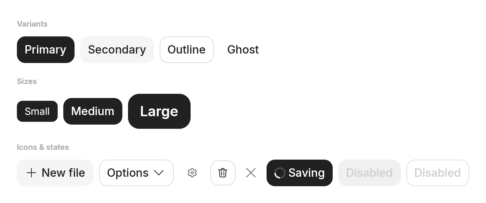

# RefineUI GPUI

The [RefineUI](https://github.com/pelagornis/refineui) design system for **desktop apps**,
built on [GPUI](https://gpui.rs). Same tokens as the web (light and dark),
with the same component anatomy, states and motion as the web kit
(`packages/react` / [ui.pelagornis.com](https://ui.pelagornis.com)), adapted for macOS:
keyboard focus, hover states, menus, popovers and dialogs. An optional compact density
is available; the default matches RefineUI web sizing.



## Crates

| Crate | Description |
| --- | --- |
| [`refineui-tokens`](crates/refineui-tokens) | Colors, typography, spacing, radius, stroke, opacity, shadow, motion and size tokens. No GPUI dependency. |
| [`refineui`](crates/refineui) | GPUI theme, icons and components. |
| [`refineui-gallery`](examples/gallery) | Gallery app and screenshot generator (not published). |

## Quick start

```toml
[dependencies]
gpui = "0.2.2"
refineui = { git = "https://github.com/pelagornis/refineui-gpui" }
```

```rust
use refineui::prelude::*;

// once, at startup (and pass refineui::Assets to Application::with_assets)
refineui::init(cx);

// in a view's render()
refineui::root(cx).child(
    Button::new("save", "Save").icon(IconName::Checkmark).on_click(|_, _, _| {}),
)
```

## Components

**Actions**: Button, Toggle Button, Segmented Control, Link.
**Forms**: Input, Textarea, Search Field, Input OTP, Field, Checkbox, Radio and RadioGroup, Switch (web Toggle), Slider, Spin Button, Select.
**Display**: Text, Heading, Label, Badge, Chip/Tag, Avatar and Avatars, Card, Alert, Divider, Kbd, Spinner, Progress, ProgressStepper, Stepper, Skeleton, Tooltip, Toast and Toaster.
**Navigation**: Tabs, Breadcrumb, Pagination, Sidebar, Tree, Accordion and Collapsible, Calendar.
**Overlays**: Menu, DropdownMenu, ContextMenu, Popover, Dialog, Drawer.
**Data**: Table, Scroll Area.
**Layout**: `h_stack`, `v_stack`, `spacer`.

## Development

Requires Rust 1.88+ (see `rust-toolchain.toml`). The main target is macOS on Apple Silicon.

```sh
cargo run -p refineui-gallery            # browse every component
cargo run -p refineui-gallery --bin refineui-shell  # desktop app shell demo (titlebar, menus, activity bar, palette)
./scripts/screenshots.sh                 # regenerate docs screenshots
cd docs && bun install && bun run dev    # documentation site
```

See [AGENTS.md](AGENTS.md) for the architecture, conventions and workflows.

## Documentation

- [Docs site source](docs/) — Astro + Starlight with [starlight-theme-page](https://github.com/pelagornis/starlight-theme-page)
- [Contributing](CONTRIBUTING.md)
- [Code of Conduct](CODE_OF_CONDUCT.md)

## License

MIT; see [LICENSE](LICENSE). Bundled assets: RefineUI System Icons (MIT) and Inter (SIL OFL 1.1).
